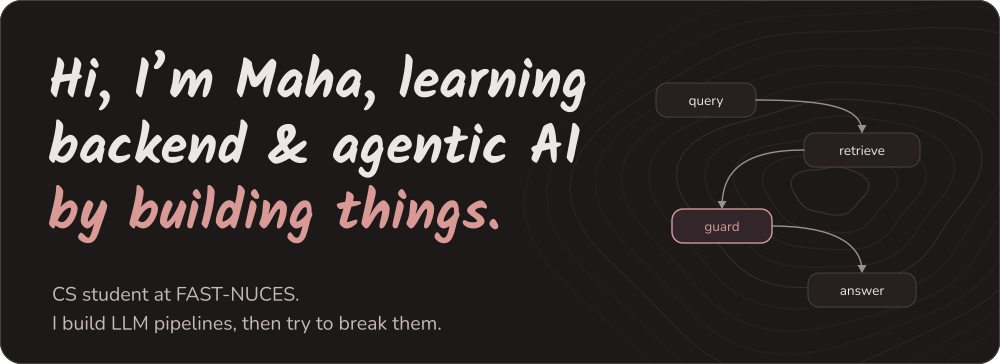
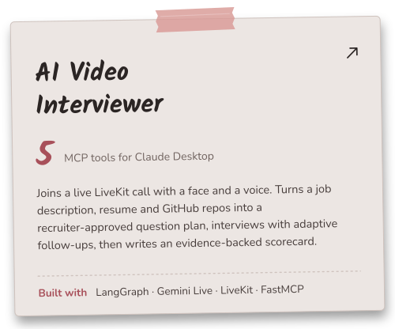
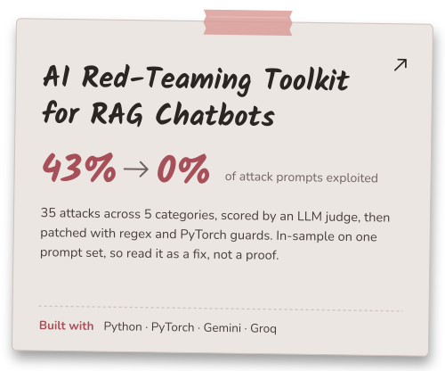
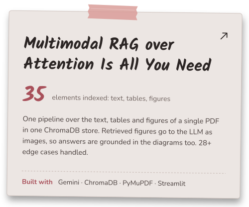
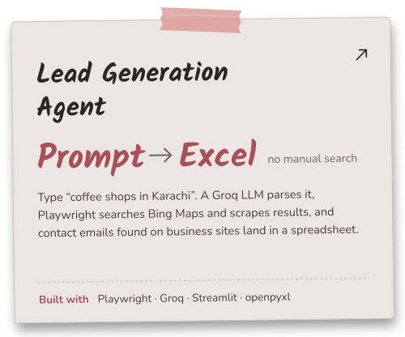
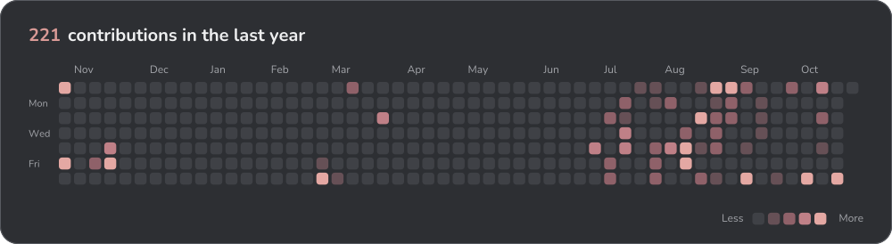

<b>Backend AI intern at Flyrank</b> &nbsp;·&nbsp; CS at FAST-NUCES, class of 2028 
Open to internships and research in backend, agentic AI and AI security

## Selected work

## Stack

#### Languages

#### AI & LLM

#### AI Security

#### Backend & APIs

#### Data & Storage

#### Realtime & Automation

#### Frontend & UI

#### Infra & Tooling

#### AI-assisted dev

## Also shipped

| Project | What it does | Built with |
|:--|:--|:--|
| [**RAG Chatbot: Chunking & Retrieval**](https://github.com/siedaa/Rag-chat-bot---aiseason) | Benchmarks 3 chunking strategies and 2 retrieval techniques with dedicated A/B scripts | `Python` `RAG` `LLM evaluation` |
| [**AI Image Relevance Engine**](https://github.com/siedaa/flyrank-capstone-image-relevance) | Flyrank capstone: matches image content to relevance behind a full FastAPI backend | `FastAPI` `Alembic` `Docker` |
| [**WhatsApp AI Chatbot**](https://github.com/siedaa/WhatsAPP-chat-Bot) | Routes each message to chat, grounded RAG answers, or recall of personal facts, over a plain WhatsApp Web login | `Node.js` `Baileys` `LangChain` `Groq` |
| [**PDF Report Generator**](https://github.com/siedaa/-PDF-report-generator) | SQL aggregation to HTML to downloadable PDF through headless Chromium, idempotent by design | `FastAPI` `SQLite` `Playwright` |
| [**Containerized Task API**](https://github.com/siedaa/Containerize-your-stack) | CRUD API plus PostgreSQL, app and database up together with one command | `FastAPI` `SQLModel` `PostgreSQL` `Docker` |
| [**DSA Color Palette Generator**](https://github.com/siedaa/dsa-color-palette-generator-cpp) | Desktop app that teaches data structures: stack-based undo/redo, circular-queue history, merge sort | `C++` `SFML` |
| [**M & I CandyPop!**](https://github.com/siedaa/-M-and-I-Candy-Pop-Game--OOP-Project.) | Match-and-clear game built to show OOP principles, with scoring and a GUI | `C++` `SFML` |

## Contributions

## Let’s connect

&nbsp;&nbsp;

